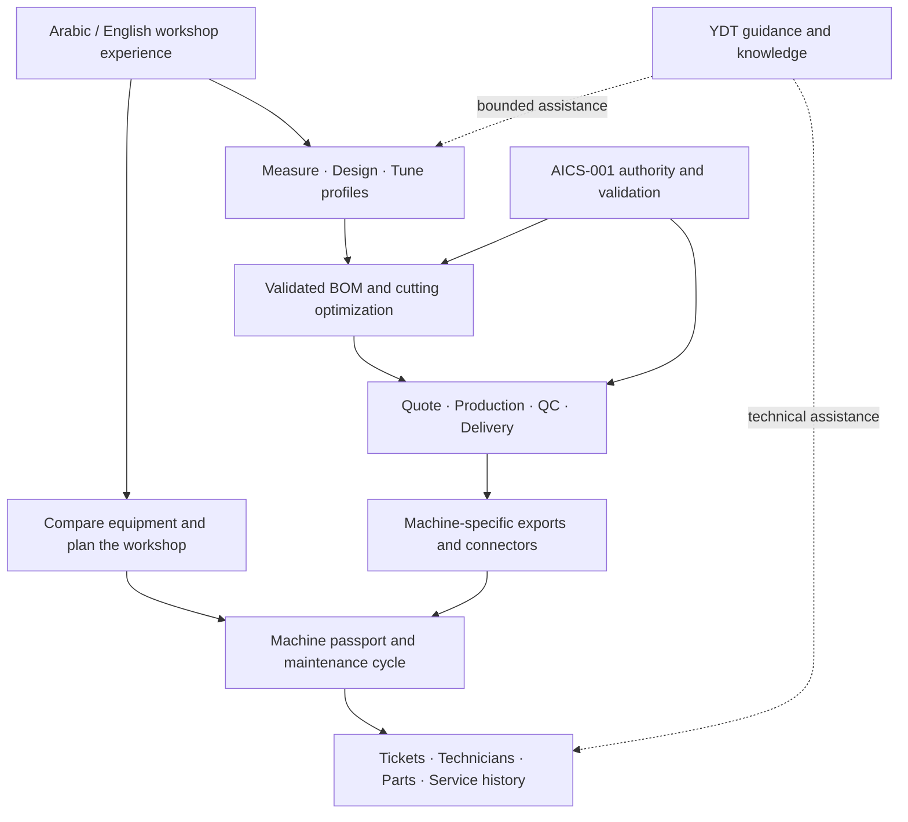

# ALMONA · Vertical Reality OS

**A connected workspace for aluminium and UPVC fabrication, machinery and workshop care.**

ALMONA brings equipment selection, workshop planning, engineering, production and after-sales service into one platform. Built around the needs of workshops in Egypt and the wider Arabic-speaking region, it combines Fabricator Pro with machinery discovery, technical assistance and machine-linked service records.

[Explore ALMONA](https://www.almona02.com/) · [Engineering principles](docs/INSTITUTIONAL_OVERVIEW.md) · [AICS-001 specification](docs/AICS-001_ALMONA_INDUSTRIAL_COMPUTING_SPECIFICATION.md)

## For workshops

Compare equipment, plan the workshop layout, prepare aluminium and UPVC jobs, calibrate profiles, optimize cutting and prepare machine-specific output. Continue the equipment lifecycle through the machine passport, service tickets and spare-parts records—in Arabic and English.

## The vision: Vertical Reality OS

Vertical Reality OS is the direction of the platform: connect the digital definition of a workshop to its physical work. A profile, opening, cutting plan, machine and service event should belong to a traceable operational story.

The goal is a continuous loop—from choosing equipment and arranging the workshop, through calibrated fabrication and reviewed production, to maintenance that informs the next job. The codebase implements these connected workspaces; deeper machine connectivity and lifecycle automation continue to develop around them.

## What the platform brings together

| Workspace | Purpose |
|---|---|
| **Machinery discovery and comparison** | Browse machine specifications and documentation, compare equipment, and review options against workshop needs. The public catalogue and model documents are readable before JavaScript runs. [Comparison tools](src/components/shop/EquipmentComparisonTool.tsx) |
| **Workshop planner** | Arrange machines, workbenches, storage, assembly areas, utilities and access points in a dimensioned layout, then export a workshop plan to PDF. [Layout planner](src/components/products/FactoryLayoutPlanner.tsx) |
| **Fabricator Pro** | Carry projects and positions through measurement, design, drafting, bills of materials, stock and cutting optimization, commercial documents, and production/QC workflows. [Workflow model](src/store/workflowStore.ts) |
| **Profile tuning and calibration** | Refine profile and system data, cutting calibration and K-factors, machining zones and workshop rules before using them in manufacturing calculations. [Profile Tuning Studio](src/components/fabricator/tuning/ProfileTuningStudio.tsx) |
| **Machine integration** | Prepare machine-specific production output through CNC exporters, controller adapters, validation and YILMAZ network/USB bridge components. Direct connectivity requires the matching machine, protocol and configured bridge. [Machine connectors](src/machine-connectors/) |
| **Maintenance cycle and machine passport** | Connect registered equipment to support tickets, technician work, service contracts and preventive visits. The passport view brings serial-linked tickets, service history, documentation and recorded spare parts together. [Machine passport workspace](src/pages/machines/DigitalTwinDashboard.tsx) |
| **YDT technical assistance** | Provide contextual technical guidance, knowledge retrieval and service-ticket assistance, with governance separating recommendations from manufacturing authority. [YDT services](src/lib/ydt/) |
| **3D and AR machine visualizer** | Explore equipment spatially and assess workshop placement through 3D/AR interfaces. Available experiences depend on the model assets and device/browser capabilities. [AR viewer](src/components/shop/3d-configurator/ARViewer.tsx) |

## Engineered as connected layers

The application separates workshop interaction, manufacturing calculations, operational records and machine interfaces. Project and position identity connect the workflow; browser workers handle BOM/DXF workloads; service APIs and role-aware workspaces support customer, administrator and technician responsibilities.

The engineering depth is in these contracts: a position keeps its identity across revisions; approved profile data informs BOM and cutting calculations; commercial and production steps retain their workflow context. Machine service history is associated with registered equipment and serial-linked tickets. This provides the foundation for a connected lifecycle as integration coverage grows.



| Layer | Foundation |
|---|---|
| Workshop application | React, TypeScript, Vite, query caching and workflow state |
| Engineering | Profile/system packs, calibration, deterministic BOM and optimization, browser workers |
| Operational data | Supabase identity, PostgreSQL records and access policies; application service APIs |
| Technical services | Python/FastAPI, with Redis and Celery infrastructure for background workloads |
| Spatial and physical interfaces | Three.js-based views, AR interfaces, CNC adapters and machine bridges |

### AICS constitutional engineering

**AICS-001—the Almona Industrial Computing Specification—is the project's engineering governance specification.** It defines authority, validation and separation of responsibilities around geometry, material, machine, process and certification truth.

The architecture distinguishes strategic guidance, bounded execution assistance and protected deterministic calculations. YDT can provide context and recommendations; it must not silently replace approved profile rules, dimensions or manufacturing formulas. Revision-aware state, validation envelopes, audit evidence and operator approval connect engineering decisions to production release.

See the [authority layer](src/core/authority/constitution/) and [intelligence gate](src/lib/ydt/IntelligenceGate.ts).

## Egypt and Arabic at the core

Arabic and English resources, right-to-left interfaces, Egyptian profile/system data such as Panda and Caluminium PS, regional defaults and EGP-aware commercial workflows make localization part of the workshop model. Egyptian technical vocabulary and local fabrication context also inform YDT's assistance.

**من تخطيط الورشة إلى التصنيع والصيانة، في بيئة عمل عربية وإنجليزية مترابطة.**

[Language resources](locales/) · [Regional interfaces](src/components/regional/) · [Egyptian fabrication context](src/lib/intelligence/EgyptianFabricationIntelligence.ts)

## Where the platform is heading

- Strengthen the link between approved profile calibration, released production and machine acknowledgements.
- Extend the machine passport across installation, maintenance, parts and future condition data.
- Bring workshop planning, spatial visualization and fabrication decisions closer together.
- Deepen Arabic workshop workflows and governed YDT assistance while preserving deterministic engineering boundaries.

## Local development

Use Node.js 22.22.2 (within the repository's Node 22 engine range), npm and Python 3.11 for backend work.

```bash
npm ci
cp .env.example .env
npm run dev
```

The frontend runs on port `3000`. To run the technical-assistance backend:

```bash
cd python_backend
python -m venv .venv
# Activate the virtual environment for your shell.
pip install -r requirements-dev.txt
cp .env.example .env
python -m uvicorn api.prestige_endpoints:app --host 0.0.0.0 --port 8000
```

Configure development credentials locally and keep environment files out of Git. See [AGENTS.md](AGENTS.md) for contribution guidance and verification commands.

## License

No public license is declared. All rights reserved unless the repository owner states otherwise.
