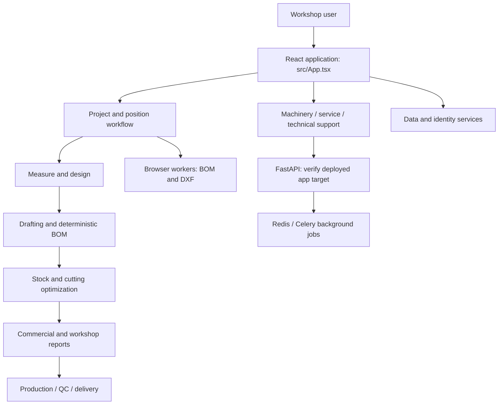

# ALMONA Portfolio Forge

Aluminium and UPVC fabrication software for window and door workshops: position design, bills of materials (BOM), cutting optimization, quoting and production control, alongside machinery sales and service operations.

ALMONA is a web platform for aluminium and UPVC workshops in Egypt and the Middle East. It combines Almona Co.'s machinery catalogue, spare-parts and service workflows with Fabricator Pro, a workspace for measuring openings, designing positions, generating bills of materials, optimizing stock, preparing quotes, and producing workshop documents.

- Website: [www.almona02.com](https://www.almona02.com/)
- Repository: [github.com/almona02/almona-portfolio-forge](https://github.com/almona02/almona-portfolio-forge)
- Backend health: [Railway health endpoint](https://almona-portfolio-forge-production.up.railway.app/health)

## Project status — verified 19 October 2026

ALMONA is an implemented industrial web platform undergoing production hardening and workshop acceptance. Its engineering work spans fabrication calculations, manufacturing evidence, commercial controls, machinery services and operational administration. A single prototype label or an arbitrary four-phase score does not describe these separate areas accurately.

**Scope of this snapshot:** main at `b71d4c60`; quality improvements in [LINTS #99](https://github.com/almona02/almona-portfolio-forge/pull/99) are identified separately while that PR remains open. Implementation, automated verification, deployment and workshop acceptance are distinct evidence levels.

### Implemented product and engineering work

| Area | Implemented scope | Source evidence |
| --- | --- | --- |
| Fabricator Pro | Project/position workflow: Measure → Design → Drafting/BOM → Optimization → Commercial → Production; identity-scoped hydration, stock-demand reconciliation and workshop documents | [Workflow state](src/store/workflowStore.ts), [workflow routes](src/lib/fabricator/routes.ts), [BOM and inventory](src/lib/fabricator/) |
| Manufacturing controls | Approved-context qualification, physical-cut/ledger reconciliation, revision-aware state and server-side QC approval calls | [BOM qualification](src/lib/fabricator/bom/bomQualification.ts), [physical-cut contract](src/lib/fabricator/optimization/physicalCutContract.ts), [QC client](src/lib/fabricator/qualityApproval.ts) |
| Engineering tools | Engineering Bay, system packs, drafting, 3D previews, cutting/nesting algorithms, BOM and DXF browser workers | [Engineering Bay](src/components/fabricator/EngineeringBay.tsx), [system packs](src/data/systemPacks.ts), [algorithms](src/algorithms/), [workers](src/workers/) |
| Commercial operations | Quotes, workshop-customer invoices, manual receipts, currency checks and portal ownership contracts | [Commercial modules](src/modules/commercial/), [recorded October 16 rollout](docs/audits/COMMERCIAL_PRODUCTION_ROLLOUT_2026-10-16.md) |
| Machinery and after-sales | Machine catalogue, used machines, support tickets, assignments, service contracts, preventive visits and evidence/share workflows | [Machine catalogue administration](src/components/admin/panels/MachinesAdminPanel.tsx), [service API](src/lib/serviceContractApi.ts), [ticket API](src/lib/adminTicketApi.ts), [ticket evidence API](src/lib/ticketMessageApi.ts) |
| Operational administration | Role-specific landing routes; admin, fabricator-admin and technician workspaces; product/service pricing, profiles/accessories, system configuration, settings and user roles | [Role routing](src/lib/roleRouting.ts), [admin sections](src/components/admin/adminNavigation.ts), [configuration API](src/lib/fabricatorConfigApi.ts), [settings API](src/lib/appSettingsApi.ts) |
| Workshop usability | Arabic/English interfaces, responsive review/production flows, accessible admin navigation, keyboard filters, focus management and route-state persistence | [Localisation](locales/), [accessibility review](docs/reviews/ADMIN_ACCESSIBILITY_REVIEW_2026-10-18.md) |
| Runtime foundations | Lazy routes, production chunk checks, PWA caching, Redis/Celery infrastructure and Python technical-assistance APIs | [Application router](src/App.tsx), [Vite configuration](vite.config.ts), [backend](python_backend/), [October 16 implementation record](docs/audits/IMPLEMENTATION_STATUS_2026-10-16.md) |

These entries establish code and recorded engineering work. Individual features still need their own deployment, authorization, workload and workshop acceptance evidence; a source directory alone does not prove end-to-end readiness.

### Current verification and operational evidence

- **Public availability, checked 19 October:** the website and Railway `/health` endpoint returned HTTP 200. The backend reported overall `degraded`: database and Redis checks were healthy, while the `railway_services` check was unhealthy. Reachability does not establish full dependency health or authenticated workflow acceptance.
- **Recent merged work:** PRs [#97](https://github.com/almona02/almona-portfolio-forge/pull/97), [#100](https://github.com/almona02/almona-portfolio-forge/pull/100) and [#101](https://github.com/almona02/almona-portfolio-forge/pull/101) cover the admin/service/configuration series and pricing/RLS follow-ups. Merged code is not independent proof that every role and price-edit path has passed live user acceptance.
- **Open quality work, LINTS #99:** two parallel batches removed **190 ESLint warnings across 16 source files**. Its latest full scan reports **2,356 files, zero ESLint errors and 16,076 remaining warnings**; **52 focused tests passed**. The type-regression gate passed with **1,665 existing application errors** against the unchanged 1,791-error baseline. These are results on the PR branch, not a claim that main is type-clean or that the full test suite passed.
- **Earlier manufacturing evidence:** the October 6 reports recorded 84-test and 22-test focused runs. They are historical evidence, not the current total number of application tests. Later reviews and releases must be read at their own revision and environment.

See the [current evidence and assessment reconciliation](docs/PROJECT_STATUS.md) for exact sources, verification scope and the distinction between implemented capabilities and open acceptance work.

### Manufacturing acceptance

The October 6 disposable-fixture run was blocked by missing approved manufacturing authority and dimensional tolerance. Later staging records describe additional successful and negative-path checks. This status review does not establish that a complete current production job has passed approved system rules, stock consumption, release, QC and delivery end to end.

Production output requires approved profile-system data, dimensional tolerances, operator review and traceable release evidence. No formal industrial/ISO certification, universal machine-export compatibility, measured factory capacity or guaranteed accuracy percentage is claimed. The phrase **“Phase 2.5 of 4” is not a repository-defined or independently validated maturity rating**.

## Manufacturing boundaries

Manufacturing-critical paths are designed to be deterministic and auditable. Identical validated inputs should produce identical protected-path outputs. Support responses and reference search results must not silently become manufacturing truth.

The platform does not claim structural engineering authority. Profile-system rules, tolerances, formulas, and workshop output require approved source data and human sign-off. Accuracy percentages are not published as guarantees until they are supported by representative, independently reviewed production evidence.

See [Institutional Overview](docs/INSTITUTIONAL_OVERVIEW.md) and [Fabricator V2 Constitutional Migration Runbook](docs/FABRICATOR_V2_CONSTITUTIONAL_MIGRATION_RUNBOOK.md).

## Architecture

| Area | Main technology |
| --- | --- |
| Frontend | React 18, TypeScript, Vite, Tailwind CSS, shadcn/ui |
| Data and auth | Supabase PostgreSQL, Row Level Security |
| Backend | Python 3.11, FastAPI, Uvicorn |
| Cache and jobs | Redis, Celery where required |
| Hosting | Vercel for the frontend, Railway for the backend |
| Tests | Vitest, React Testing Library, Playwright, pytest |

The frontend runs on port `3000` during development and proxies `/api` to the backend on port `8000`.



The supplied GitDiagram captures the product areas but omits position identity, BOM workers, production/QC, persistence and job infrastructure. Its `app.py` box does not identify the deployed backend: the repository contains `api.prestige_endpoints:app`, `apis.main:app` and `apis.v2.app:app`. Diagram edges summarize responsibilities, not guaranteed transactional or deployment boundaries.

### Heavy-duty scalability review — 2026-10-18

The repository contains useful scaling foundations: lazy routes, chunk configuration, browser workers, background-job configuration and performance-test scripts. Their presence does not establish concurrent workshop capacity.

Priorities are to reconcile API/worker deployment targets, benchmark representative large jobs, bound queue concurrency and cache growth, make retried stock/release operations idempotent, and measure browser responsiveness and memory over long shifts. Evaluate Node and React major upgrades separately from manufacturing changes, with deterministic replay and renderer compatibility checks.

See the [architecture comparison and prioritized performance review](docs/audits/SCALABILITY_AND_ARCHITECTURE_REVIEW_2026-10-18.md) for source evidence, upgrade references, acceptance criteria and remaining SEO work. No throughput, accuracy or ROI guarantee is implied by this review.

## Local development

### Prerequisites

- Node.js `20.19` or newer, below Node 23
- npm
- Python 3.11

### Frontend

```bash
git clone https://github.com/almona02/almona-portfolio-forge.git
cd almona-portfolio-forge
npm install
cp .env.example .env
npm run dev
```

### Backend

```bash
cd python_backend
python -m venv .venv
# Activate .venv using your shell, then:
pip install -r requirements-dev.txt
cp .env.example .env
python -m uvicorn api.prestige_endpoints:app --host 0.0.0.0 --port 8000
```

Environment files contain credentials and must stay outside commits. Use separate development credentials; never reuse production service keys locally.

## Verification

```bash
npm run security:gate1
npm run type-check
npm run lint
npm run test
npm run build

cd python_backend
python -m pytest tests/test_api.py -v
```

Remote PostgreSQL and Redis may be unavailable in an isolated local environment. In that case, dependency health checks can report degraded while API tests that do not require those services still run. Production readiness requires the hosted dependencies to pass.

Useful focused gates:

```bash
npm run validate:constitutional
npm run verify:shipability
npm run test:e2e
```

## Repository map

```text
src/
  components/             React UI and Fabricator workspaces
  lib/fabricator/         Manufacturing models, BOM, validation, optimization
  pages/                  Application routes and workflow screens
  store/                  Identity-aware workflow state
  tests/                  Frontend integration and regression tests
python_backend/
  api/                    FastAPI endpoints
  tests/                  Backend tests
supabase/
  migrations/             Database schema, functions, and policies
docs/
  audits/                 Evidence and parity audits
  launch/                 Launch and database repair records
```

## Remaining release work

The highest-priority work is tracked openly:

1. Complete authenticated live acceptance of the full Fabricator flow, including hard reloads and a second-account isolation run.
2. Reconcile the backend health response so optional or legacy dependency checks do not contradict authoritative database and Redis checks.
3. Apply and record every production Supabase migration, then finish the RLS and privileged-function cross-customer audit.
4. Close open dependency alerts, beginning with critical and high severity findings.
5. Rotate legacy production credentials through a controlled deployment and verify every consumer afterward.
6. Validate profile-system formulas, tolerances, piece reconciliation, and production documents against representative workshop jobs before making accuracy claims.

Product improvements that follow the release gates include continuous plausibility checks, thermal/U-value reporting, route and dashboard consolidation, shop-floor scanning/MES, live supplier data, BIM exchange, and ERP integration. See [Deferred Work](docs/DEFERRED_WORK.md) and the dated evidence under [docs/audits](docs/audits/).

## Contributing

Keep changes small and scoped. New TypeScript must remain strict and manufacturing changes need boundary, unit-conversion, and deterministic replay tests. Database changes require additive migrations and policy tests. Pull requests must pass the relevant CI, security, constitutional, and shipability gates.

For concurrent contributions, assign a bounded task and explicit file ownership to each contributor. Use separate branches or worktrees, agree on shared interfaces before changing them, and designate one coordinator to integrate the results. Each handoff should include changed files, verification outcomes, remaining blockers, and dependencies. Run relevant integration checks after combining changes.

Keep repository navigation and verified implementation status concise and linked to source files. Dated audit records describe the state when they were written; verify the current checkout before treating their test counts or release findings as current evidence.

Public product descriptions should explain workshop capabilities and their validation limits without tool endorsements, provider branding, unsupported superiority claims, or comparisons with other commercial products.

Do not commit `.env` files, service-role keys, customer data, or production exports. Report security issues privately to the repository owner rather than opening a public issue.

## License

No public license has been declared. All rights are reserved unless the repository owner states otherwise.
